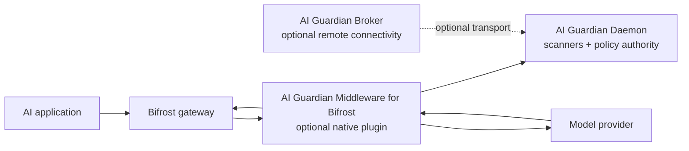
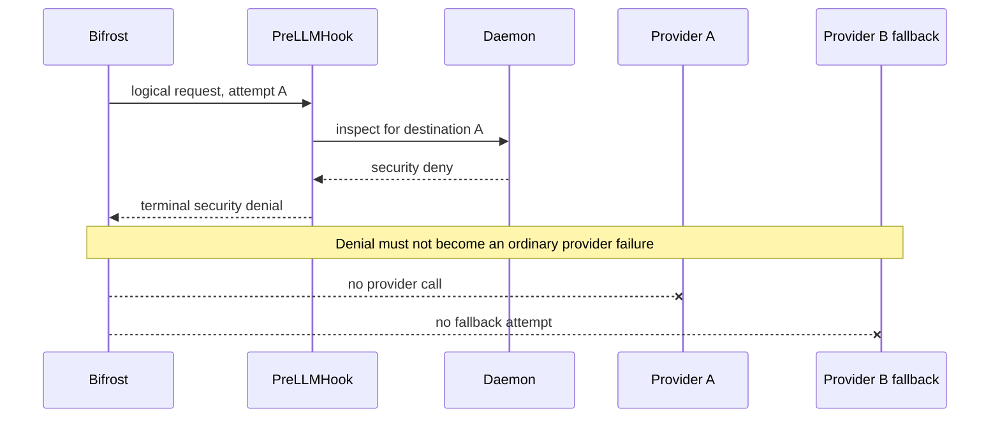

# AI Guardian Middleware for Bifrost

**Issue:** #2862 (architecture spike); implementation follow-up: #2861  
**Status:** Discovery baseline for implementation planning  
**Updated:** 2026-11-25

## Decision Summary

AI Guardian Middleware for Bifrost should be an optional native Bifrost plugin,
implemented in Go and built against one pinned Bifrost core revision and Go
toolchain. The Bifrost plugin is an enforcement adapter; the AI Guardian Daemon
remains the authority for scanning, policy evaluation, redaction, and security
verdicts. The AI Guardian Broker is not on the mandatory data path and is only an
optional transport/discovery option for a remote daemon.

The initial implementation target is Bifrost OSS `v2.6.0`, represented by the
`transports/v2.6.0` tag (commit `172617bb045c6f43d697843c115e64f0155ed143`).
This is a compatibility target, not yet a completed runtime qualification. The
plugin must fail startup or enter an explicitly disabled state when its compiled
hook contract does not match the gateway.

The MVP should enforce:

- outbound request inspection before every provider attempt;
- embeddings, including each item in batched inputs, where the hook exposes them;
- non-streaming response inspection before delivery;
- authenticated local Unix-socket or explicitly configured remote daemon access;
- trusted, operator-configured project and policy mapping; and
- fail-closed behavior for daemon, authentication, timeout, malformed-verdict,
  and response-inspection failures.

Streaming response redaction/blocking, native realtime/WebSocket frames, OAuth
passthrough, gateway MCP traffic, and background-operation coverage remain
conditional until Bifrost source-level and harness validation proves the exact
hook ordering and commitment boundary.

## Repository and Artifact Layout

The implementation lives under `go/bifrost-middleware/` as an independent Go
module. Keeping the plugin module separate from the Python package and the
existing Rust OpenShell middleware prevents unrelated language toolchains from
participating in plugin builds while preserving one repository and release
version.

```text
go/bifrost-middleware/
├── compatibility.json       # pinned Bifrost revision/toolchain/artifacts
├── go.mod                   # Go 1.27.4 module boundary
├── internal/                # daemon client, identity, policy, hook adapter
└── tests/                   # contract and Bifrost harness tests
```

The first release artifacts are Linux AMD64 and ARM64 shared objects. macOS
AMD64 and ARM64 remain later targets. Windows is not a native `.so` target
because Go's standard `plugin` mechanism does not provide a supported Windows
implementation. Artifact names, target priority, and runtime requirements are
tracked in `go/bifrost-middleware/compatibility.json`.

Release filenames include all host-selection inputs, for example
`ai-guardian-bifrost-v2.6.0-go1.27.4-linux-amd64.so`. Users should select the
asset matching their installed Bifrost version, Go toolchain, operating system,
and architecture rather than choosing by CPU architecture alone.

The plugin is not independently portable merely because its CPU architecture
matches the host. Bifrost must be built with dynamic plugin loading enabled,
and the plugin and host must match the pinned Bifrost source, Go toolchain,
architecture, and relevant build settings. Until those inputs are available,
the repository metadata is a compatibility contract, not a claim that a
prebuilt `.so` is distributable. A compatible Bifrost executable or container
may be required for deployment and is a separate release artifact decision.

### Installation Contract

Installation is intentionally an operator action, not part of the AI Guardian
Python installer. The operator selects the release asset whose filename matches
the Bifrost version, Go toolchain, operating system, and architecture; verifies
the published SHA-256 checksum; and copies the shared object to a protected,
operator-owned Bifrost plugin directory. The absolute plugin path is then
registered in Bifrost's plugin configuration and Bifrost is restarted or
reloaded using its documented lifecycle command.

The plugin must not be loaded from a writable project or user-content
directory. Daemon endpoint credentials belong in the deployment's protected
environment or secret store and must never be embedded in plugin configuration
examples or logs. The Python installer does not install Bifrost, replace its
host binary, or automatically configure a gateway.

The AI Guardian daemon is a prerequisite for enforcement. The operator must
install the normal AI Guardian package, create its configuration and scanners,
and start the daemon before starting Bifrost:

```bash
ai-guardian setup --create-config --install-scanner
ai-guardian daemon start -b
ai-guardian daemon status
```

The plugin uses the protected local Unix socket by default, normally
`~/.local/state/ai-guardian/daemon.sock`. `AI_GUARDIAN_DAEMON_SOCKET` can point
to an explicitly configured local socket. For remote deployments,
`AI_GUARDIAN_DAEMON_URL` selects an authenticated HTTPS daemon endpoint and
`AI_GUARDIAN_DAEMON_TOKEN_FILE` or the protected token configuration supplies
its credential. These values belong to the Bifrost service environment; they
are not accepted from client requests. If the configured daemon cannot be
reached or returns an invalid verdict, the security-enforcing profile fails
closed. `AI_GUARDIAN_BIFROST_FAILURE_MODE=fail_open` is an explicit
monitoring-only mode for control-plane failures; it does not convert an
explicit daemon security denial into an allow or provider fallback.

## Responsibilities



The plugin owns hook registration, bounded serialization, request correlation,
verdict validation, and conversion of verdicts into Bifrost short-circuits or
response mutations. It must not duplicate scanner engines, infer policy from
caller-controlled fields, or select an arbitrary daemon endpoint.

The AI Guardian Daemon owns scanner selection, policy evaluation, redaction,
violation persistence, and the final security decision. The Broker, if used,
only supplies an authenticated, authorized route to a daemon; it does not
become a scanner or policy authority.

### Enforcement flow

```mermaid
sequenceDiagram
    participant App as AI application
    participant Bifrost
    participant Plugin as Bifrost plugin
    participant Daemon as AI Guardian Daemon
    participant Provider
    App->>Bifrost: request
    Bifrost->>Plugin: PreLLMHook (attempt N)
    Plugin->>Daemon: bounded content + checks + correlation ID
    alt deny or control-plane failure
        Daemon-->>Plugin: block or invalid/unavailable
        Plugin-->>Bifrost: security short-circuit
        Bifrost-->>App: denial; no provider call
    else allow
        Daemon-->>Plugin: validated allow
        Plugin-->>Bifrost: continue
        Bifrost->>Provider: provider request
        Provider-->>Bifrost: response
        Bifrost->>Plugin: PostLLMHook
        Plugin->>Daemon: bounded response content
        Daemon-->>Plugin: allow, redact, or block
        Plugin-->>Bifrost: pass, replacement, or delivery denial
        Bifrost-->>App: protected response
    end
```

### Provider-attempt invariant



## OpenShell Precedent

The existing implementation is an architectural precedent, not a transport
contract. It is an external Rust service under
`rust/openshell-middleware/`, registered and policy-selected by OpenShell.

| Concern | OpenShell implementation | Bifrost adaptation |
| --- | --- | --- |
| Extension boundary | External Rust gRPC service | In-process Go `.so` plugin |
| Request gate | `EvaluateHttpRequest` at `PRE_CREDENTIALS` | `PreLLMHook` per provider attempt; HTTP pre-hook only where transport coverage is needed |
| Response gate | Streaming RPC with explicit body mode | `PostLLMHook` for buffered responses; transport response/chunk hooks only after commitment semantics are verified |
| Daemon transport | Protected Unix socket by default; authenticated HTTP alternative | Reuse the same daemon contract and credential rules through a Go client |
| Policy | Validated scanner ownership and explicit scan plan | Plugin configuration maps to daemon checks; unsupported mappings reject configuration |
| Failure | Request and response control-plane errors deny | Deny provider attempt and prevent fallback from treating denial as ordinary provider failure |
| Payload safety | Bounded body/message sizes; no arbitrary stream retention | Equivalent limits; reject or fail closed when Bifrost cannot provide a complete inspectable unit |
| WebSocket | Text messages inspected; binary denied; session state rechecked | Defer until Bifrost native realtime/WebSocket hook semantics are verified |

Concrete precedent evidence:

- `daemon.rs` defaults to the protected daemon socket, requires an explicit URL
  and bearer token for remote REST, sends selected checks, `action=block`, a
  correlation ID, and optional project directory, and treats malformed or
  unavailable control-plane responses as errors.
- `policy.rs` rejects scanner ownership `both`, rejects unsupported
  `supply_chain` and `config_file_scanning` for this REST path, and makes
  redaction ownership explicit.
- `http.rs` binds request inspection to `PRE_CREDENTIALS`, enforces a payload
  limit, and returns a denial when the daemon is unavailable.
- `response.rs` requires `WHOLE_BODY_BYTES` for body-bearing responses because
  the protocol forbids retaining input across arbitrary stream units. It allows
  `HEADERS_ONLY` only for bodyless responses and blocks unavailable inspection.
- `websocket.rs` validates session ordering and sequence numbers, denies binary
  payloads and oversized messages, and rechecks daemon pause state per message.

These properties should be retained conceptually, but their Go/Bifrost
implementation must follow Bifrost's native types and error semantics.

## Bifrost Compatibility Boundary

Official Bifrost plugin documentation describes Go shared-object plugins loaded
with `plugin.Open`. The plugin and gateway must match OS, architecture, and Go
version. The documented v2 hook order is:

1. `HTTPTransportPreAuthHook` (HTTP transport, before authentication)
2. `HTTPTransportPreHook` (HTTP transport, after authentication)
3. `PreRequestHook` once per logical request
4. `PreLLMHook` per provider attempt
5. Provider call
6. `PostLLMHook` per provider attempt
7. `HTTPTransportPostHook`
8. `HTTPTransportResponseHeadersHook`
9. `HTTPTransportStreamChunkHook`

The documentation explicitly says `PreRequestHook` errors are non-blocking and
that `PreLLMHook` is the short-circuit-capable per-attempt seam. Therefore
`PreRequestHook` must not be the sole security gate. It may record routing
metadata, but enforcement must happen in `PreLLMHook` before each provider call.

The plugin must pin and verify all of the following against the selected
`v2.6.0` source before implementation:

- exact exported function signatures and schema field availability;
- whether a `PreLLMHook` short-circuit is classified as a provider error;
- whether fallback selection runs after a plugin denial;
- whether `PostLLMHook` sees a response before any client-visible commitment;
- whether transport hooks run for every supported API surface and background
  operation;
- whether stream chunks can be withheld until a complete safe unit is known;
- whether native realtime/WebSocket setup and frames traverse these hooks; and
- whether OAuth passthrough and provider-native passthrough bypass core hooks.

The documented plugin contract is evidence of availability, not proof of
security effectiveness. Those questions require source inspection and focused
runtime tests in #2861.

## Enforcement Contract

### Request path

For each logical request, the plugin should create a non-secret correlation
record containing a gateway request ID, provider-attempt ID, operation kind,
destination class, model, and trusted project identity. It sends bounded content
to the daemon using the existing middleware check shape:

```json
{
  "content": "<bounded serialized request content>",
  "checks": ["injection", "context_poisoning", "secrets", "pii"],
  "action": "block",
  "correlation_id": "<opaque id>",
  "project_dir": "<operator-mapped canonical path>"
}
```

The payload must omit provider credentials, authorization headers, and other
transport secrets. Embeddings are content-bearing requests: each batch item
must be bounded and inspected, or the whole batch must be denied when the
selected daemon contract cannot represent item-level results safely.

An explicit daemon block becomes a Bifrost short-circuit with a stable,
non-secret reason code such as `ai_guardian_denied`. It must be tagged as a
security denial in plugin context so Bifrost cannot classify it as an ordinary
provider failure eligible for fallback.

### Response path

For a complete non-streaming response, the plugin sends the response content to
the daemon before returning it to the caller. A block prevents delivery; an
authorized redaction replaces the response body atomically. A malformed
replacement, invalid verdict, or daemon failure blocks delivery.

For streaming, inspecting each chunk independently is insufficient for findings
that span chunks or split UTF-8. The plugin must either obtain a documented
bounded whole-response boundary before release, maintain a daemon-approved
streaming protocol with safe state, or fail closed before sending content. It
must never claim full response protection merely because a chunk hook exists.

### Retry and fallback invariant

The security decision is evaluated before every provider attempt. A denial is a
terminal security outcome for the logical request, not a retryable upstream
failure. The plugin must preserve a denial marker in request context and tests
must prove that configured fallback providers are not attempted after denial.

Clean verdicts may be evaluated again for each attempt because destination-aware
policy can differ by provider, region, or local/cloud classification.

## Identity, Policy, and Connectivity

The plugin trusts only operator configuration and authenticated daemon identity:

- Local mode uses the permission-protected Unix socket by default.
- Remote mode requires an explicitly configured endpoint, TLS verification, and
  a protected bearer token or equivalent authenticated channel.
- Broker-mediated connectivity is optional and must preserve target and client
  authorization; a caller cannot supply an arbitrary daemon URL or target ID.
- Project directories are canonicalized and selected by operator mapping. A
  caller-provided project path or policy name is metadata, not authorization.
- Missing project context uses a configured default policy or is denied when the
  policy requires project identity. It must not silently inherit another
  request's context.
- Daemon identity, policy version, and scanner ownership are checked during
  plugin initialization and configuration reload.

No unredacted request, response, credential, or daemon token may be written to
plugin logs. Logs should contain only correlation IDs, operation/provider class,
bounded byte counts, decision, reason code, and audit-safe finding summaries.

## Coverage Matrix

| Traffic or operation | Proposed seam | Spike conclusion | MVP |
| --- | --- | --- | --- |
| Chat completions | `PreLLMHook` / `PostLLMHook` | Supported if schemas and short-circuit semantics verify | Yes |
| Responses API | Same hooks | Supported if typed content is fully serializable | Yes |
| Embeddings, batched | `PreLLMHook` | Required; item-level or whole-batch bounded inspection must be proven | Yes |
| Codebase indexing | Embedding hook path | Candidate coverage; verify Kilo request path reaches Bifrost | Yes if path is covered |
| Automatic memory generation | LLM hook path | Candidate coverage; verify independent background client configuration | Validate, then yes |
| Non-streaming response | `PostLLMHook` | Suitable for pre-delivery inspection if no earlier commitment | Yes |
| Streaming response | transport chunk/header hooks | Bifrost pause/resume gate buffers chunks until the bounded assembled response is inspected; denied buffers are cleared before termination | Supported with bounded end-of-stream inspection; delivery begins after the final decision |
| Native realtime/WebSocket | setup/session hooks | No verified v2.6.0 frame hook; HTTP setup alone does not cover frames | Unsupported; fail closed until adapter/harness proof |
| ChatGPT OAuth passthrough | transport/auth path | Unverified; must prove credentials are never sent to daemon and content still reaches gate | Defer |
| Gateway MCP operations | `PreMCPHook` / `PostMCPHook` | Separate surface; requires explicit tool/argument/result policy mapping | Defer |
| Provider retry/fallback | per-attempt `PreLLMHook` | Must be tested as a security invariant | Yes |

Coverage labels mean: **Supported** is source and harness verified;
**Partial** has a hook but lacks a safe complete-content contract;
**Unverified** has documentation evidence only; **Deferred** is outside MVP.

## Failure Matrix

| Condition | Required behavior |
| --- | --- |
| Daemon unavailable or timeout | Deny before provider call or response delivery in the default `fail_closed` mode; explicit `fail_open` monitoring mode may resume the held stream |
| Authentication/TLS failure | Deny; do not fall back to another daemon or provider |
| Invalid verdict or replacement | Deny and record a protocol-error audit event |
| Explicit security block | Terminal denial; no provider fallback |
| Payload exceeds configured limit | Deny without scanning |
| Unsupported operation/schema | Deny or reject plugin configuration; never silently pass |
| Daemon paused | Follow explicit daemon pause contract; document whether request inspection skips or denies |
| Provider transport failure after clean verdict | Bifrost may retry according to its policy, but every new attempt re-enters the request gate |
| Plugin unavailable/disabled | Existing AI Guardian agent-only deployments remain independent; middleware-only mode must not advertise protection |

Fail-open may be offered only as an explicit, separately documented monitoring
mode (`AI_GUARDIAN_BIFROST_FAILURE_MODE=fail_open`). It is not acceptable as
the default for a security-enforcing profile and must never turn an explicit
security denial into a provider retry.

### Realtime/WebSocket enforcement boundary

The current Bifrost plugin does not claim native realtime/WebSocket coverage.
The v2.6.0 compatibility target verifies the HTTP and LLM hook surface, but it
does not establish that an upgrade hook observes the complete session or that
frame decisions occur before delivery. Therefore the native realtime path is
unsupported rather than implicitly allowed.

The Go middleware includes a bounded `webSocketSession` contract for a future
adapter. A compliant adapter must gate the upgrade, inspect complete text
frames in sequence, and release no frame before an allow decision. Per-session
state is bounded to 256 messages, the configured payload size, and five minutes
of inactivity. Query data is stripped before daemon inspection. Binary frames,
malformed input, cancellation, expiry, daemon failure, malformed verdicts, and
explicit denials terminate the session. Explicit security denials remain
terminal regardless of failure-open policy.

## Deployment Modes

- **Agent-only:** existing hooks and daemon behavior; Bifrost is absent.
- **Middleware-only:** Bifrost plugin plus authenticated daemon; protects traffic
  that traverses the configured gateway, including eligible background requests.
- **Hybrid:** agent hooks and Bifrost middleware share the daemon policy. Scanner
  ownership must be explicit to avoid duplicate redaction or conflicting
  decisions; the OpenShell `both` rejection is a useful precedent.

Bifrost and the Broker are optional. Installing or removing the plugin must not
  change standalone daemon, tray, Console, SDK, or agent integrations.

## MVP and Follow-up Issues

### #2861 MVP prerequisites

1. Pin Bifrost OSS `v2.6.0` source revision and matching Go toolchain.
2. Implement authenticated daemon client using the existing check semantics.
3. Implement `PreLLMHook` request enforcement per provider attempt.
4. Implement bounded embeddings and batched-input tests.
5. Implement non-streaming response block/redaction before delivery.
6. Add denial-versus-fallback regression tests.
7. Add local Unix-socket and authenticated remote-daemon tests with identity and
   project-policy mapping.
8. Add a Kilo indexing fixture proving whether background embeddings traverse the
   gate.

### Separate follow-ups

- Qualify a daemon-compatible incremental streaming state protocol. The native
  stream-chunk hook currently uses Bifrost's bounded pause/resume gate, so clean
  streams are delivered after final inspection and denied buffers are cleared
  before termination.
- Qualify native realtime/WebSocket session and frame hooks.
- Qualify OAuth passthrough and provider-native passthrough surfaces.
- Define gateway MCP request/result policy mapping.
- Add a shared, versioned middleware contract only if OpenShell and Bifrost
  implementations demonstrate a stable common semantic need. Do not refactor
  OpenShell as part of #2861.
- Define Broker integration only through #2640 boundaries; do not make Broker a
  Bifrost prerequisite.

## Readiness Assessment

#2861 is **not ready for unrestricted implementation** until the Bifrost source
and harness answer the compatibility questions above. It is ready for a narrow
MVP implementation only if the team pins the exact `v2.6.0` build/toolchain and
accepts the following gate: request enforcement and non-streaming response
enforcement are fail-closed, per-attempt denials cannot trigger fallback, and
unsupported streaming/realtime/passthrough paths are explicitly denied or
documented as outside the protection boundary.

The principal residual risk is a documented hook that runs after a response or
stream has already become client-visible. No Bifrost hook name alone resolves
that risk; the implementation must prove commitment ordering with source review
and integration tests.

## Evidence

- Bifrost plugin documentation: <https://docs.getbifrost.ai/plugins/getting-started>
- Bifrost Go plugin guide: <https://docs.getbifrost.ai/plugins/writing-go-plugin.md>
- Initial source target: `transports/v2.6.0`, commit
  `172617bb045c6f43d697843c115e64f0155ed143`
- OpenShell middleware README: `rust/openshell-middleware/README.md`
- OpenShell daemon contract: `rust/openshell-middleware/src/daemon.rs`
- OpenShell policy mapping: `rust/openshell-middleware/src/policy.rs`
- OpenShell request enforcement: `rust/openshell-middleware/src/http.rs`
- OpenShell response enforcement: `rust/openshell-middleware/src/response.rs`
- OpenShell WebSocket enforcement: `rust/openshell-middleware/src/websocket.rs`
- OpenShell protocol contract: `src/ai_guardian/middleware/openshell/v0_1_2/proto/supervisor_middleware.proto`
