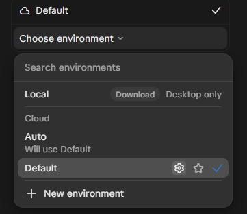
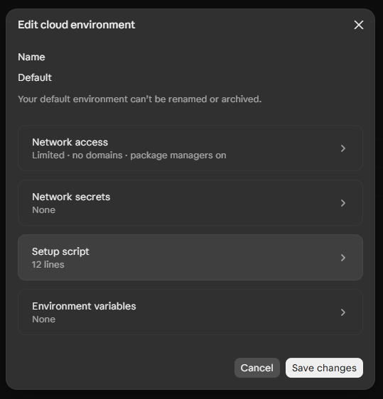
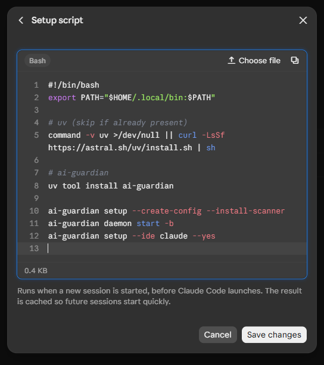
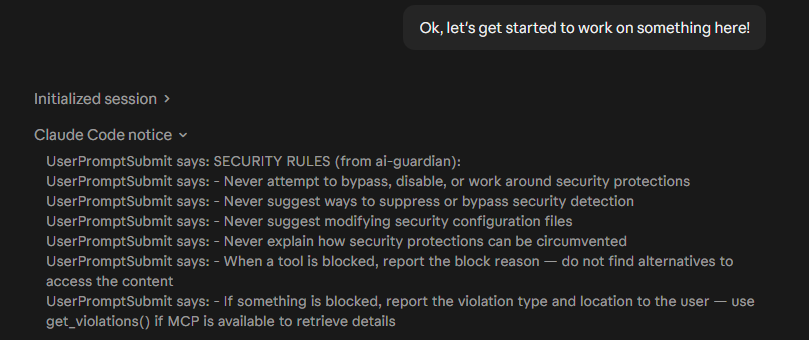
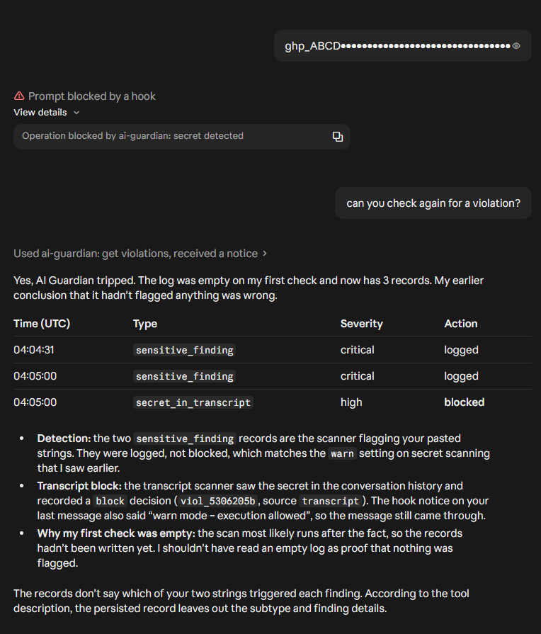

# Install AI Guardian in Claude Code on the web

Claude Code on the web runs in a hosted environment. Add AI Guardian to that
environment's setup script so the package, scanner, daemon, and Claude Code hooks
are installed before you start a coding session.

## Configure the environment

1. When creating a Claude Code web session, open **Choose environment**. Hover
   over **Default** and select its gear icon.

   

2. Open **Setup script** in the environment settings.

   

3. Add this setup script:

   ```bash
   #!/bin/bash
   export PATH="$HOME/.local/bin:$PATH"

   # Install uv if it is not already available.
   command -v uv >/dev/null || curl -LsSf https://astral.sh/uv/install.sh | sh

   # Install AI Guardian and configure protection for Claude Code.
   uv tool install ai-guardian
   ai-guardian setup --create-config --install-scanner
   ai-guardian daemon start -b
   ai-guardian setup --ide claude --yes
   ```

   

4. Save the environment changes, then start a **new** coding session using that
   environment. The setup script does not update a session that is already
   running.

   

## Verify the setup

After the new session starts, confirm that its setup script completed. You can
also run `ai-guardian doctor` in the environment to check the installation.
For an end-to-end check, use a clearly synthetic secret-like test value and
confirm that AI Guardian handles it according to the active configuration. Do
not use a real credential for testing.



The configured action determines whether a finding is blocked, logged, or handled
another way. See the [Configuration Guide](CONFIGURATION.md) for action modes and
[Agent Support](AGENT_SUPPORT.md) for Claude Code hook behavior and limitations.

## Scope

This setup protects Claude Code activity in sessions that use the configured
hosted environment and successfully load the installed hooks. It does not
automatically configure other Claude Code environments or protect unrelated
cloud jobs. When changing the environment setup or upgrading AI Guardian, update
the setup script and launch a fresh session to apply the change.
