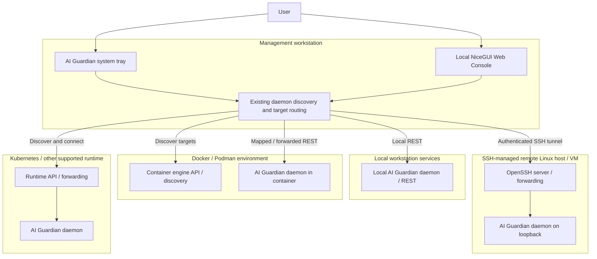
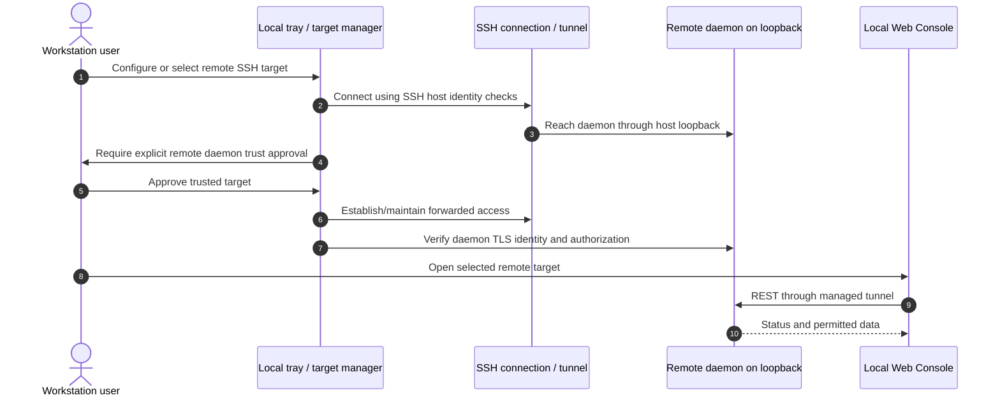
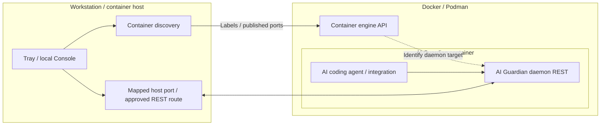
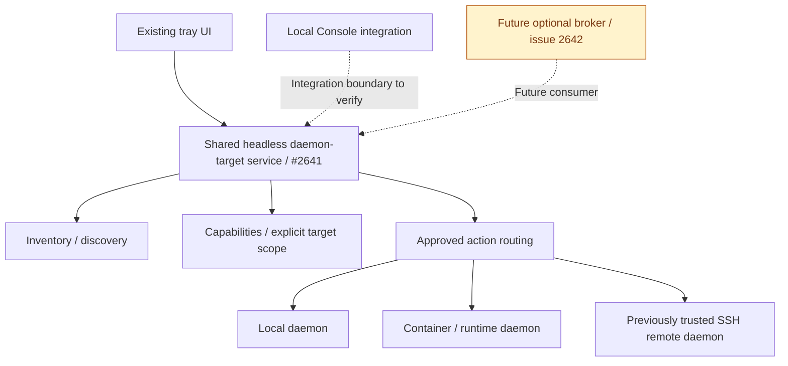
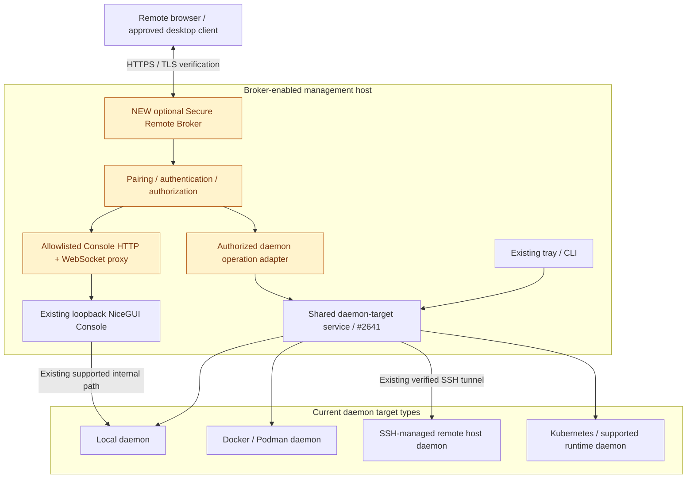
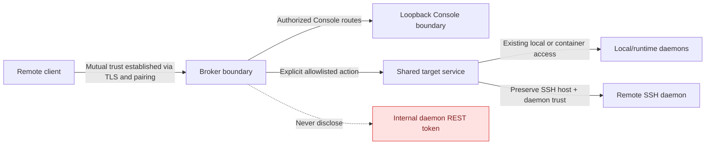
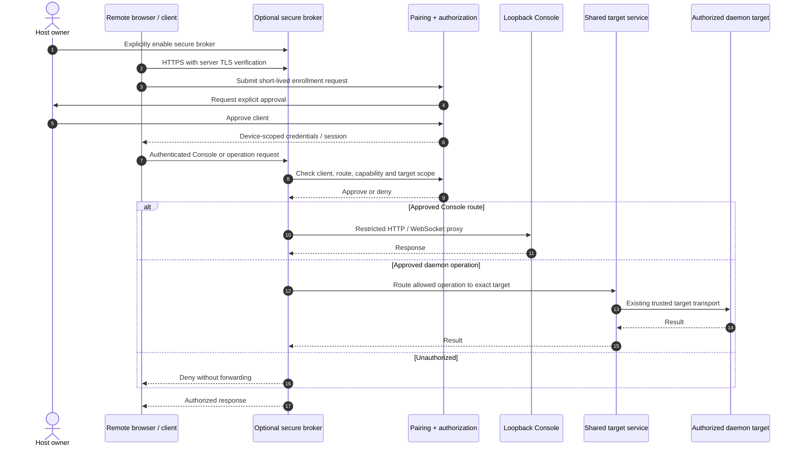
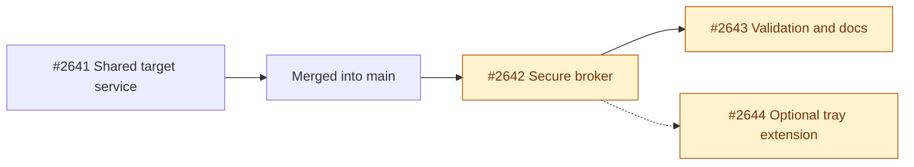

# AI Guardian — Remote Daemon & Secure Broker Architecture

**Architecture document for:** [Epic #2640](https://github.com/RedHatProductSecurity/ai-guardian/issues/2640)  
**Updated:** 2026-11-23  
**Status:** Current architecture + proposed future architecture. Diagrams are conceptual rather than exact Python module or port wiring.

> **Important:** The optional Secure Remote Broker is a proposed feature, not part of the currently deployed architecture. The shared daemon-target service for #2641 is implemented in [PR #2835](https://github.com/RedHatProductSecurity/ai-guardian/pull/2835), which is merged into `main` as of this update. GitHub marks #2641 closed; the implementation is now present in `main`.

## 1. Existing architecture — local and remote daemon targets

Today, local management already includes local daemons and remote/runtime targets. A remote SSH daemon does **not** need the proposed broker to be managed; the workstation establishes an SSH connection and forwards access to a daemon that remains on the remote host's loopback interface.

**Diagram interpretation:** The tray and Console are user interfaces; discovery, transport and lifecycle control are simplified into one conceptual routing box. Exact capabilities differ by target/runtime. Container port publication determines exposure, and SSH remote hosts retain their own daemon listener and trust boundaries.

### 1a. SSH-managed remote daemon — existing access flow

**Existing SSH model:** The workstation owns the connection; the remote daemon REST port does not need to be publicly exposed. SSH host verification and daemon identity verification are separate trust steps. The diagram depicts an intended logical sequence, not a guaranteed command-level implementation order.

### 1b. Container daemon — existing discovery and access

A daemon bound to all interfaces *inside* a container is not necessarily reachable from other machines; exposure depends on published ports, bind addresses and host firewall rules. The proposed broker must not silently widen any of those boundaries.

## 2. What issue #2641 changes — reusable target service

Issue #2641 extracts headless, reusable daemon-target inventory, capability checks and action routing from the tray, while preserving existing local/tray behavior. Its implementation is present in **[PR #2835](https://github.com/RedHatProductSecurity/ai-guardian/pull/2835)**, merged into `main` as of 2026-11-23.

**Boundary note:** The shared service and tray refactor are covered by #2641. The Console's exact adoption of that service and the broker-to-service adapter are integration points to confirm during implementation; the dashed arrows must not be read as already completed work. SSH support must preserve its existing explicit trust/enrollment rules and only expose operations the shared service can safely authorize.

## 3. Proposed architecture — optional secure broker (#2640 / #2642)

The broker is an **additional remote management entry point**. It is *not* an alternative scanning engine and is *not* required for existing tray, Console, local container or SSH-managed daemons.

**Security separation:** Remote clients authenticate to the broker, **not directly to the daemon's internal REST API**. The broker checks the requested operation and exact daemon target, then forwards only allowed requests. Existing internal daemon and Console interfaces remain loopback/internal. Browser session and WebSocket security details must be specified and tested in #2642.

### 3a. Trust boundaries

The dotted path to the daemon token is a **prohibited information flow**, not a valid request path.

## 4. Proposed pairing / authorized request flow

The credential/session details are conceptual until implemented by #2642. WebSocket upgrades and individual target operations require authorization; there must not be an unauthenticated generic reverse proxy.

## 5. Rollout states and failure independence

| State | Local protection and daemon | Local tray / Console | Existing SSH / container daemon management | Broker-mediated remote browser access |
| --- | --- | --- | --- | --- |
| Current `main` after #2641 merge | Available | Available | Available where configured | Not implemented |
| Future broker disabled | Unchanged | Available | Available | Unavailable by design |
| Future broker enabled and healthy | Unchanged | Available | Available | Authenticated and authorized |
| Future broker stopped or failed | **Must remain available** | **Must remain available** | **Must remain available** | Unavailable |

The broker is explicitly **optional** in #2640. **Disabled by default** is a recommended secure default, but must not be described as a confirmed issue acceptance criterion without further specification.

## 6. Issue-to-component map and live development status

| Issue / PR | Responsibility | Status at last review (2026-11-23) | Dependencies / next step |
| --- | --- | --- | --- |
| [#2640](https://github.com/RedHatProductSecurity/ai-guardian/issues/2640) | Secure remote access epic | Open | Tracks broker delivery |
| [#2641](https://github.com/RedHatProductSecurity/ai-guardian/issues/2641) | Shared headless discovery and action routing, tray reuse | GitHub issue closed; implementation merged into `main` | Broker consumes the shared service |
| [PR #2835](https://github.com/RedHatProductSecurity/ai-guardian/pull/2835) | Implementation of #2641 | **Merged** | Use the shared service for broker integration |
| [#2642](https://github.com/RedHatProductSecurity/ai-guardian/issues/2642) | Optional secure host broker, TLS, pairing, authorization, Console proxy | Planned / open | Consume shared service from #2641 |
| [#2643](https://github.com/RedHatProductSecurity/ai-guardian/issues/2643) | Cross-host qualification, negative tests, setup documents | Planned | After broker slice; update this architecture document |
| [#2644](https://github.com/RedHatProductSecurity/ai-guardian/issues/2644) | Optional tray integration of broker-backed target | Planned / optional | After broker interfaces stabilize; update this architecture document |

## 7. Architectural invariants and open design decisions

1. **Opt-in broker:** local hooks/SDK, scanning, daemon, tray and Console do not depend on broker health.
2. **No REST exposure by accident:** keep internal Console and daemon REST endpoints on loopback/internal networks. Container publication rules remain independently controlled.
3. **Preserve existing SSH trust:** no automatic discovery-to-trust escalation; keep verified SSH identity, daemon trust and explicit target selection.
4. **Explicit pairing and revocation:** use device-scoped, expiring/revocable credentials; do not reuse host OS password or disclose daemon REST tokens.
5. **Allowlisted routing:** authorize both operation *and* precise daemon target, including redirects, WebSocket upgrades and errors.
6. **One shared target service:** #2642 must consume the #2641 abstraction, not recreate tray discovery or import UI code.
7. **No implicit transitive authorization:** being paired to a management host must not automatically grant access to every SSH, Kubernetes or container target known to that host. Define per-client/target scopes in #2642.
8. **Failure independence:** a dead broker should not prevent local protection or existing SSH/container management.
9. **Clarify remote Console scope:** specify whether the Console proxy displays just the broker host or any authorized existing target; align its selection state with the operation router.
10. **Document deployment boundaries:** direct LAN, VPN and reverse proxy deployment must specify TLS termination, trusted interface, session handling and expected firewall controls.
11. **Keep documentation current:** every follow-up issue that changes broker, target-routing, validation, deployment, or tray behavior must update this document and its issue-to-component map before the issue is closed.

## References

- [#2640 Remote access epic](https://github.com/RedHatProductSecurity/ai-guardian/issues/2640)
- [#2641 Shared daemon routing](https://github.com/RedHatProductSecurity/ai-guardian/issues/2641)
- [PR #2835 — shared target service implementation](https://github.com/RedHatProductSecurity/ai-guardian/pull/2835)
- [#2642 Secure broker implementation](https://github.com/RedHatProductSecurity/ai-guardian/issues/2642)
- [#2643 Cross-host validation](https://github.com/RedHatProductSecurity/ai-guardian/issues/2643)
- [#2644 Optional tray extension](https://github.com/RedHatProductSecurity/ai-guardian/issues/2644)
- [Multi-daemon tray design](https://github.com/RedHatProductSecurity/ai-guardian/blob/main/docs/MULTI_DAEMON_TRAY.md)
- [Console documentation](https://github.com/RedHatProductSecurity/ai-guardian/blob/main/docs/CONSOLE.md)
